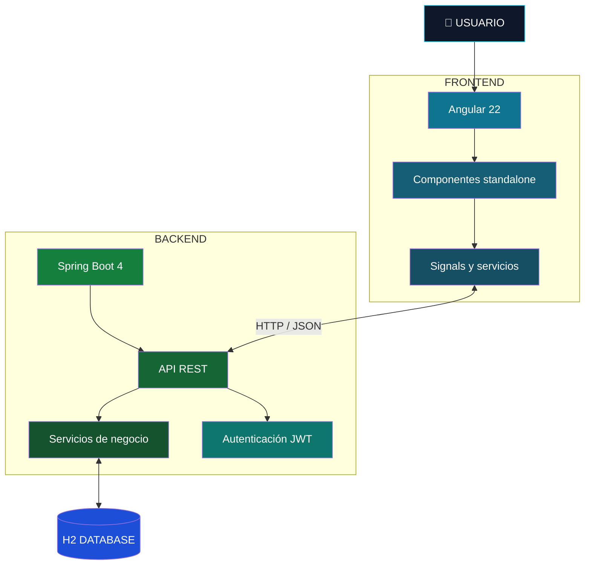
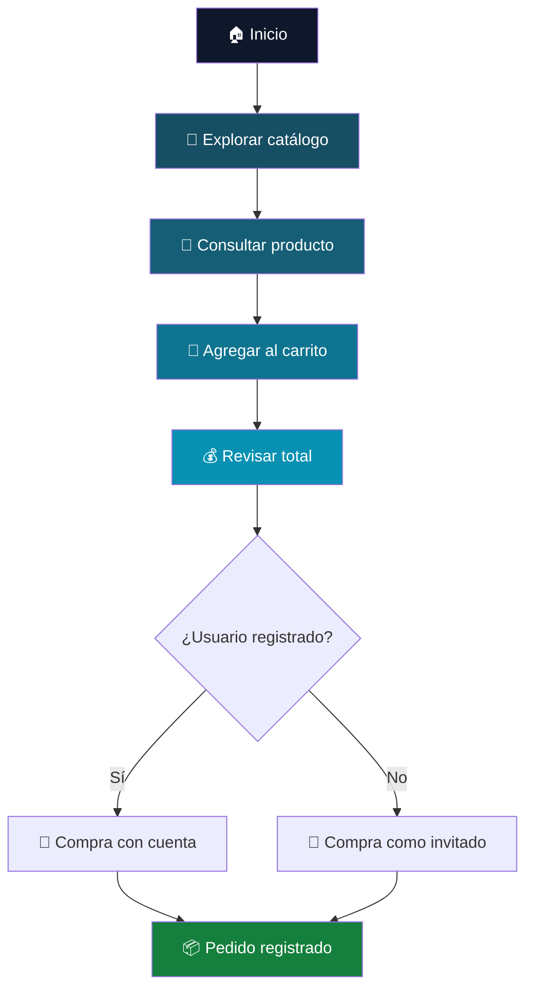
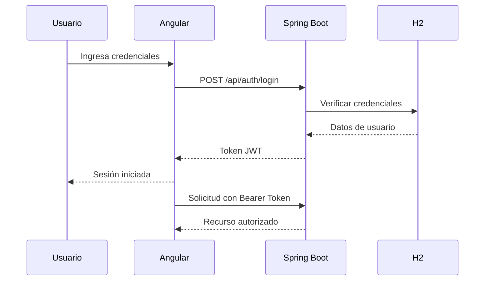
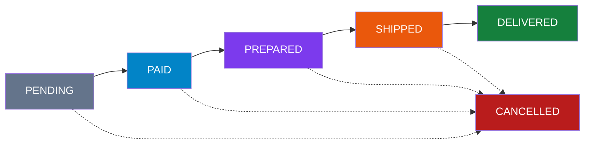
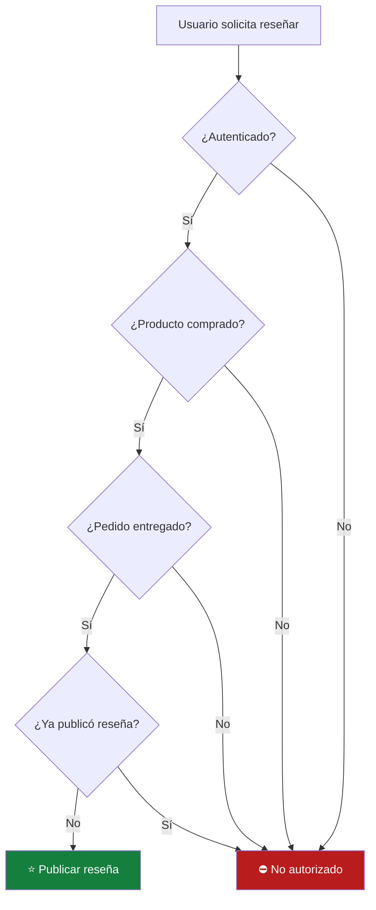
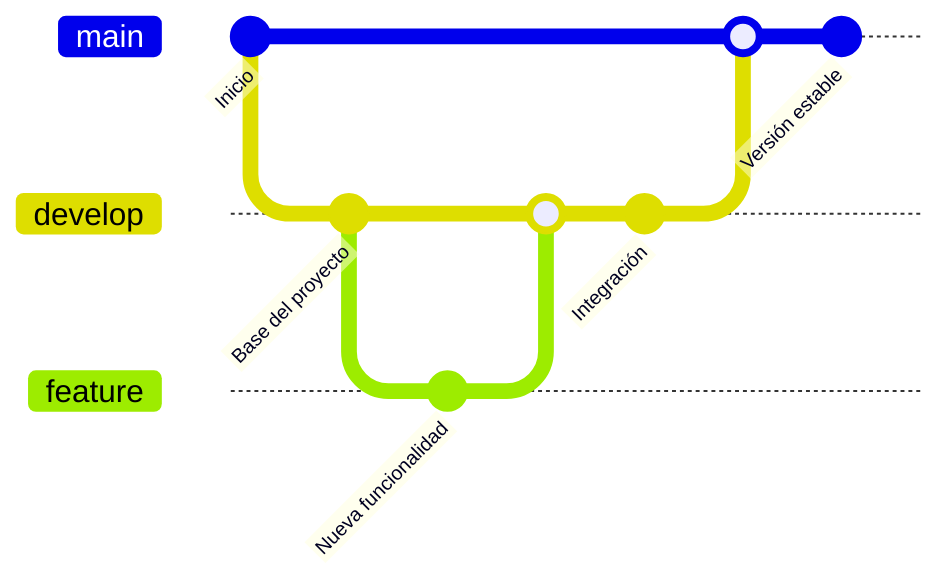
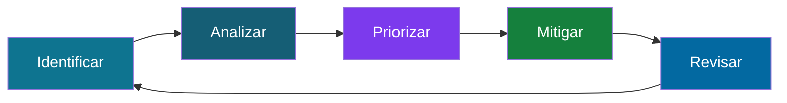

<!-- ========================================================= -->
<!--                                                           -->
<!--                     P A R D R O P S                       -->
<!--                                                           -->
<!--                DIGITAL COMMERCE PLATFORM                  -->
<!--                   PREMIUM README                          -->
<!--                                                           -->
<!-- ========================================================= -->

<div align="center">


### ✦ E X P L O R A · D E S C U B R E · C O M P R A ✦

**El comercio digital, reinventado para una experiencia más simple.**

Una plataforma e-commerce moderna, intuitiva y construida con tecnologías de última generación.

<br/>

[](https://github.com/andrespar2/ParDrops)


<br/>


<br/>

**[Explorar proyecto](#-sobre-el-proyecto) · [Instalación](#-instalación) · [Arquitectura](#-arquitectura) · [API](#-api-rest)**

</div>

---

## 💠 Identidad digital

```text
██████╗  █████╗ ██████╗ ██████╗ ██████╗  ██████╗ ██████╗ ███████╗
██╔══██╗██╔══██╗██╔══██╗██╔══██╗██╔══██╗██╔═══██╗██╔══██╗██╔════╝
██████╔╝███████║██████╔╝██║  ██║██████╔╝██║   ██║██████╔╝███████╗
██╔═══╝ ██╔══██║██╔══██╗██║  ██║██╔══██╗██║   ██║██╔═══╝ ╚════██║
██║     ██║  ██║██║  ██║██████╔╝██║  ██║╚██████╔╝██║     ███████║
╚═╝     ╚═╝  ╚═╝╚═╝  ╚═╝╚═════╝ ╚═╝  ╚═╝╚═════╝ ╚═╝     ╚══════╝
```

<div align="center">

### ✦ PARDROPS · DIGITAL COMMERCE ✦

**E X P L O R A · D E S C U B R E · C O M P R A**

> Más que una tienda online: una experiencia digital completa.

</div>

---

## 📑 Navegación

<details>
<summary><b>📂 Abrir índice de documentación</b></summary>

<br/>

| Sección | Descripción |
|---|---|
| [🌐 Sobre el proyecto](#-sobre-el-proyecto) | ¿Qué es ParDrops? |
| [🎯 Objetivos](#-objetivos) | Propósito del sistema |
| [✨ Características](#-características) | Funcionalidades principales |
| [🧩 Tecnologías](#-tecnologías) | Stack tecnológico |
| [🏗 Arquitectura](#-arquitectura) | Funcionamiento interno |
| [📁 Estructura](#-estructura-del-repositorio) | Organización del código |
| [🚀 Instalación](#-instalación) | Cómo ejecutar ParDrops |
| [👥 Usuarios](#-roles-de-usuario) | Roles y permisos |
| [💰 Comercio](#-configuración-comercial) | IVA, precios y envíos |
| [📡 API](#-api-rest) | Endpoints disponibles |
| [🔐 Seguridad](#-seguridad) | Autenticación JWT y Google |
| [📦 Pedidos](#-gestión-de-pedidos) | Estados y seguimiento |
| [⭐ Reseñas](#-sistema-de-reseñas) | Valoraciones verificadas |
| [🗄 Base de datos](#-base-de-datos) | Persistencia local |
| [⚙️ GCS](#-gestión-de-configuración-del-software) | Control de cambios |
| [🛡️ Riesgos](#-gestión-de-riesgos) | Riesgos técnicos |
| [👨‍💻 Desarrollo](#-desarrollo) | Información del proyecto |

</details>

---

# 🌐 Sobre el proyecto

**ParDrops** es una plataforma web de comercio electrónico desarrollada para proporcionar una experiencia de compra moderna, rápida, intuitiva y organizada.

Permite a los usuarios:

- 🔎 Explorar un catálogo digital.
- 🛍️ Descubrir productos.
- 📄 Consultar información detallada.
- 🛒 Agregar artículos al carrito.
- 🧾 Registrar pedidos.
- 👤 Crear cuentas personales.
- 📦 Consultar su historial de compras.
- ⭐ Publicar reseñas de productos recibidos.

El proyecto utiliza una arquitectura separada entre frontend y backend, comunicados mediante una API REST.

> [!IMPORTANT]
> ParDrops está configurado para operar en Colombia, utilizando pesos colombianos (COP), IVA del 19 % y reglas de envío específicas.

---

# 🎯 Objetivos

### Objetivo general

Desarrollar una plataforma de comercio electrónico moderna que facilite la exploración de productos, la gestión de compras y la administración de pedidos mediante una interfaz intuitiva y una arquitectura de software organizada.

### Objetivos específicos

| Objetivo | Descripción |
|---|---|
| 🎨 Diseño | Crear una interfaz atractiva y responsive |
| 🛍️ Catálogo | Presentar productos de manera organizada |
| 🔐 Seguridad | Implementar autenticación JWT |
| 🛒 Compras | Facilitar la gestión del carrito |
| 📦 Pedidos | Registrar y administrar compras |
| 👤 Usuarios | Permitir registro y autenticación |
| ⭐ Reseñas | Validar opiniones mediante compras entregadas |
| ⚙️ Administración | Gestionar productos y pedidos |

---

# ✨ Características

<table>
<tr>
<td width="50%" valign="top">

### 🛍️ Catálogo digital

Exploración de productos con precios, imágenes y descripciones detalladas.

</td>
<td width="50%" valign="top">

### 🛒 Carrito de compras

Cálculo de subtotal, IVA, envío y total.

</td>
</tr>
<tr>
<td valign="top">

### 🔐 Autenticación

Registro e inicio de sesión con JWT o con tu cuenta de Google.

</td>
<td valign="top">

### 📦 Pedidos

Registro de compras y administración de estados.

</td>
</tr>
<tr>
<td valign="top">

### ⭐ Reseñas verificadas

Valoraciones disponibles después de recibir el producto.

</td>
<td valign="top">

### 🛠️ Administración

Creación, edición y eliminación de productos, además de gestión de pedidos.

</td>
</tr>
</table>

---

# 🧩 Tecnologías

<div align="center">

### FRONTEND


**Angular 22 · TypeScript · HTML · CSS**

<br/>

### BACKEND


**Java 25 · Spring Boot 4 · Maven**

<br/>

### DEVELOPMENT


</div>

<br/>

| Tecnología | Función |
|---|---|
| Angular 22 | Interfaz web SPA |
| Angular Signals | Gestión reactiva del estado |
| Standalone Components | Organización de componentes |
| TypeScript | Lógica del frontend |
| Java 25 | Lenguaje del backend |
| Spring Boot 4 | API REST |
| JWT | Autenticación |
| H2 Database | Persistencia local |
| Maven | Construcción del backend |
| Git | Control de versiones |
| GitHub | Repositorio del proyecto |

---

# 🏗 Arquitectura

ParDrops utiliza una arquitectura **cliente-servidor**, con dos aplicaciones independientes que se comunican mediante HTTP y JSON.



<details>
<summary><b>🖥️ Ver arquitectura en arte ASCII</b></summary>

```text
                 +--------------------+
                 |       USUARIO      |
                 |      NAVEGADOR     |
                 +---------+----------+
                           |
                           v
                 +--------------------+
                 |      FRONTEND      |
                 |      ANGULAR 22    |
                 |   localhost:4200   |
                 +---------+----------+
                           |
                        HTTP/JSON
                           |
                           v
                 +--------------------+
                 |       BACKEND      |
                 |    SPRING BOOT 4   |
                 |   localhost:8080   |
                 +---------+----------+
                           |
                +----------+----------+
                |                     |
                v                     v
        +---------------+     +---------------+
        |      JWT      |     |  H2 DATABASE  |
        |   SEGURIDAD   |     | PERSISTENCIA  |
        +---------------+     +---------------+
```

</details>

---

# 📁 Estructura del repositorio

```text
ParDrops/
│
├── pardrops/
│   ├── src/
│   ├── data/
│   │   └── pardropsdb.mv.db
│   └── mvnw.cmd
│
├── pardropsfrontend/
│   ├── src/
│   │   └── app/
│   │       └── core/
│   │           └── config/
│   │               └── api.config.ts
│   └── package.json
│
├── .tools/
│   └── jdk25/          # Opcional, no versionado
│
├── dev.ps1
│
└── README.md
```

| Carpeta | Tecnología | Responsabilidad |
|---|---|---|
| `pardrops/` | Spring Boot 4 | Backend y API REST |
| `pardropsfrontend/` | Angular 22 | Interfaz de usuario |
| `pardrops/data/` | H2 | Base de datos local |
| `.tools/jdk25/` | JDK 25 | Java portátil opcional |

---

# 🚀 Instalación

## 01 — Requisitos

| Herramienta | Versión |
|---|---|
| Java JDK | 25 |
| Node.js | 20+ |
| npm | Compatible con Node.js |
| PowerShell | Windows |
| Git | Para clonar el repositorio |

No necesitas instalar una base de datos externa.

## 02 — Clonar repositorio

```bash
git clone https://github.com/andrespar2/ParDrops.git
cd ParDrops
```

## 03 — Arranque rápido

Desde PowerShell:

```powershell
.\dev.ps1
```

El script:

1. Busca el JDK 25 disponible.
2. Instala dependencias del frontend si es necesario.
3. Inicia el backend.
4. Inicia el frontend.
5. Abre ambos servicios en ventanas separadas.

### Orden de búsqueda de Java

```text
.tools/jdk25
     |
     v
  JAVA_HOME
     |
     v
  JAVA en PATH
```

## 04 — Acceder al proyecto

| Servicio | Dirección |
|---|---|
| 🛍️ Frontend | http://localhost:4200 |
| ⚙️ Backend | http://localhost:8080 |
| 📡 API REST | http://localhost:8080/api |

> [!TIP]
> Para utilizar la plataforma, abre `http://localhost:4200` después de iniciar ambos servicios.

<details>
<summary><b>⚙️ Ejecución manual del backend</b></summary>

Si tienes el JDK portátil:

```powershell
$env:JAVA_HOME = (Resolve-Path ".\.tools\jdk25").Path
```

Si Java 25 ya está configurado en el sistema, omite el paso anterior.

```powershell
cd pardrops
.\mvnw.cmd spring-boot:run
```

Backend:

```text
http://localhost:8080
```

</details>

<details>
<summary><b>🅰️ Ejecución manual del frontend</b></summary>

Desde la raíz del repositorio:

```powershell
cd pardropsfrontend
npm install
npm start
```

Frontend:

```text
http://localhost:4200
```

</details>

---

# 👥 Roles de usuario

| Funcionalidad | Invitado | Cliente | Vendedor | Admin |
|---|:---:|:---:|:---:|:---:|
| Explorar productos | ✅ | ✅ | ✅ | ✅ |
| Consultar detalles / tienda pública | ✅ | ✅ | ✅ | ✅ |
| Agregar al carrito | ✅ | ✅ | ✅ | ✅ |
| Realizar pedidos | ✅ | ✅ | ✅ | ✅ |
| Historial personal + estado por tienda | ❌ | ✅ | ✅ | ✅ |
| Reseñas elegibles | ❌ | ✅ | ✅ | ✅ |
| Solicitar ser vendedor | ❌ | ✅ | ❌ | ❌ |
| Panel de vendedor / productos propios / subpedidos | ❌ | ❌ | ✅ | ❌ |
| Editar ficha de tienda propia | ❌ | ❌ | ✅ | ❌ |
| Gestionar productos/pedidos globales | ❌ | ❌ | ❌ | ✅ |
| Gestionar solicitudes de vendedor | ❌ | ❌ | ❌ | ✅ |
| Gestionar usuarios/categorías/auditoría | ❌ | ❌ | ❌ | ✅ |

### 👤 Invitado

Puede comprar sin registrarse. Su pedido queda almacenado, pero no se vincula a un historial de cuenta.

### 🧑 Cliente

Puede iniciar sesión, consultar sus pedidos y publicar reseñas cuando haya recibido los productos correspondientes.

### 🛍️ Vendedor

Puede tener su propia tienda, publicar productos, gestionar su catálogo y preparar sus subpedidos desde el panel `/vendedor`. Solo ve y gestiona sus propios datos.

### 🛠️ Administrador

Puede administrar productos, gestionar pedidos, usuarios, categorías, solicitudes de vendedor, auditoría y actualizar estados con validación de transiciones.

---

# 🛒 Experiencia de compra



---

# 💰 Configuración comercial

<div align="center">

### 🇨🇴 COMERCIO DIGITAL EN COLOMBIA


</div>

| Concepto | Valor |
|---|---|
| Moneda | COP |
| Formato | `es-CO` |
| IVA | 19 % |
| Envío estándar | $ 25.900 |
| Envío gratis | Subtotal desde $ 400.000 |
| Decimales | 0 |

### Fórmulas comerciales

```text
+-----------------------------------------+
|           CALCULO DEL PEDIDO            |
+-----------------------------------------+
|                                         |
|  SUBTOTAL = Suma de productos           |
|                                         |
|  IVA = SUBTOTAL * 0.19                  |
|                                         |
|  ENVIO =                                |
|    0       si subtotal >= 400.000       |
|    25.900  si subtotal <  400.000       |
|                                         |
|  TOTAL = SUBTOTAL + IVA + ENVIO         |
|                                         |
+-----------------------------------------+
```

### Productos de ejemplo

| Producto | Precio COP |
|---|---:|
| 👕 Camiseta | $ 119.900 |
| 👟 Zapatillas | $ 319.900 |

Los productos iniciales son creados por `DataSeeder`.

Las reglas comerciales se definen en:

- Backend: `OrderService`
- Frontend: `cart.service.ts`

---

# 📡 API REST

**Base URL**

```text
http://localhost:8080/api
```

## 🔐 Autenticación

| Método | Endpoint | Acceso |
|---|---|---|
| `POST` | `/auth/register` | Público |
| `POST` | `/auth/login` | Público |
| `POST` | `/auth/google/exchange` | Público (limitado) |
| `GET` | `/auth/me` | Autenticado |

El acceso con Google añade dos rutas fuera de `/api`:

| Método | Endpoint | Acceso |
|---|---|---|
| `GET` | `/oauth2/authorization/google` | Público |
| `GET` | `/login/oauth2/code/google` | Público (callback de Google) |

## 🛍️ Productos

| Método | Endpoint | Acceso |
|---|---|---|
| `GET` | `/products` | Público |
| `GET` | `/products/{slug}` | Público |
| `POST` | `/products/...` | ADMIN |
| `PUT` | `/products/...` | ADMIN |
| `DELETE` | `/products/...` | ADMIN |
| `PATCH` | `/products/{id}/visibility` | ADMIN |

## 🏪 Tiendas y marketplace

| Método | Endpoint | Acceso |
|---|---|---|
| `GET` | `/stores` | Público |
| `GET` | `/stores/{slug}` | Público |
| `GET` | `/stores/{slug}/products` | Público |
| `GET` | `/stores/mine` | SELLER |
| `PUT` | `/stores/mine` | SELLER |
| `POST` | `/seller-applications` | Autenticado (CUSTOMER) |
| `GET` | `/seller-applications/me` | Autenticado |
| `GET` | `/seller-applications` | ADMIN |
| `PATCH` | `/seller-applications/{id}/decision` | ADMIN |

## 🛒 Panel de vendedor

| Método | Endpoint | Acceso |
|---|---|---|
| `GET` | `/seller/dashboard` | SELLER |
| `GET/POST/PUT/DELETE/PATCH` | `/seller/products/**` | SELLER |
| `GET/PATCH` | `/seller/orders/**` | SELLER |

## ⭐ Reseñas

| Método | Endpoint | Acceso |
|---|---|---|
| `GET` | `/products/{id}/reviews` | Público |
| `GET` | `/products/{id}/reviews/eligibility` | Público |
| `POST` | `/products/{id}/reviews` | Autenticado y elegible |

## 📦 Pedidos

| Método | Endpoint | Acceso |
|---|---|---|
| `POST` | `/orders` | Público |
| `GET` | `/orders/me` | Autenticado |
| `GET` | `/orders` | ADMIN |
| `PATCH` | `/orders/{id}/status` | ADMIN |

## 🖼️ Multimedia y notificaciones

| Método | Endpoint | Acceso |
|---|---|---|
| `POST/GET/DELETE` | `/media/**` | Autenticado |
| `GET/PATCH` | `/notifications/**` | Autenticado |

<details>
<summary><b>🧪 Ejemplos de peticiones HTTP</b></summary>

### Consultar productos

```bash
curl http://localhost:8080/api/products
```

### Consultar usuario autenticado

```bash
curl http://localhost:8080/api/auth/me \
  -H "Authorization: Bearer TU_TOKEN"
```

</details>

---

# 🔐 Seguridad

ParDrops utiliza JWT para identificar usuarios autenticados y controlar el acceso a los recursos protegidos.



### Cabecera de autenticación

```http
Authorization: Bearer <token>
```

Cuando el token falta o es inválido, el backend responde:

```http
HTTP/1.1 401 Unauthorized
Content-Type: application/json
```

### Medidas implementadas

- Autenticación mediante JWT.
- Acceso con Google mediante OAuth2/OIDC, con código temporal de un solo uso.
- Vinculación de cuentas solo con el correo verificado por Google.
- Control de acceso por roles.
- Operaciones administrativas restringidas.
- Validación de elegibilidad para reseñas.
- Identificación del autor de reseñas desde la sesión.

### Acceso con Google

1. Crea un proyecto y una credencial OAuth de tipo **Aplicación web** en
   [Google Cloud Console](https://console.cloud.google.com/).
2. Autoriza el origen `http://localhost:4200` y la URI de redirección
   `http://localhost:8080/login/oauth2/code/google`.
3. Define las credenciales y arranca la aplicación:

```powershell
$env:GOOGLE_CLIENT_ID = 'tu-client-id.apps.googleusercontent.com'
$env:GOOGLE_CLIENT_SECRET = 'tu-client-secret'
.\dev.ps1
```

Sin esas variables la aplicación arranca igual y el resto de accesos sigue
funcionando; solo queda inactivo el botón de Google.

La guía completa, el flujo paso a paso, la tabla de errores y las decisiones de
seguridad están en [`docs/autenticacion-google.md`](docs/autenticacion-google.md).

---

# 📦 Gestión de pedidos

Los pedidos siguen una secuencia controlada de estados.



| Estado | Significado |
|---|---|
| `PENDING` | Pendiente |
| `PAID` | Pagado |
| `PREPARED` | Preparado |
| `SHIPPED` | Enviado |
| `DELIVERED` | Entregado |
| `CANCELLED` | Cancelado |

> [!IMPORTANT]
> Los pedidos solo pueden avanzar siguiendo el flujo permitido. `DELIVERED` y `CANCELLED` son estados finales.

El administrador gestiona los pedidos desde:

```text
/admin/pedidos
```

---

# ⭐ Sistema de reseñas

ParDrops incorpora un sistema de valoraciones vinculado a compras reales.

### Requisitos para publicar

1. El usuario debe estar autenticado.
2. Debe haber comprado el producto.
3. El pedido debe estar entregado.
4. No debe haber reseñado anteriormente ese producto.



La validación se realiza también en el backend.

El autor de la reseña se obtiene desde la sesión autenticada.

---

# 🗄 Base de datos

ParDrops utiliza **H2 Database** en modo archivo.

Ruta local:

```text
pardrops/data/pardropsdb.mv.db
```

### Inicialización

Durante el primer arranque, `DataSeeder` crea:

- Un usuario administrador.
- Un catálogo de productos de ejemplo.
- Precios configurados en COP.

### Reinicio de datos locales

Si existen datos antiguos en otra moneda, detén el backend y elimina la carpeta local:

```text
pardrops/data/
```

Al iniciar nuevamente, la base de datos se regenera.

> [!WARNING]
> Eliminar esta carpeta borra los datos locales almacenados. Haz una copia de seguridad si necesitas conservar pedidos, usuarios o productos.

---

# 🧪 Cuentas de prueba

| Rol | Correo | Contraseña |
|---|---|---|
| Administrador | `admin@pardrops.com` | `admin123` |
| Vendedor | `vendedor@pardrops.com` | `vendedor123` |

> Las cuentas demo se generan con el `DataSeeder` en desarrollo. La tienda del vendedor de prueba es `estilo-urbano`.

Para probar el acceso con Google no hay cuenta demo: usa cualquier cuenta de
Google autorizada en la pantalla de consentimiento. La primera vez se crea un
cliente nuevo; si ya existe una cuenta local con ese correo verificado, se
vincula sin duplicarla.

### Accesos administrativos

**Productos**

```text
http://localhost:4200/admin/productos
```

**Pedidos**

```text
http://localhost:4200/admin/pedidos
```

**Cuenta personal**

```text
http://localhost:4200/cuenta
```

> [!CAUTION]
> Estas credenciales son exclusivamente para desarrollo y demostraciones locales. No deben utilizarse en un despliegue público.

---

# ⚙️ Gestión de configuración del software

La **Gestión de Configuración del Software (GCS / SCM)** permite mantener el control sobre los cambios realizados durante el desarrollo de ParDrops.

### Objetivos

- Mantener un historial de cambios.
- Identificar versiones del proyecto.
- Facilitar el trabajo colaborativo.
- Controlar modificaciones en frontend y backend.
- Reducir errores durante la integración.

### Herramientas

| Herramienta | Propósito |
|---|---|
| Git | Registro de cambios |
| GitHub | Repositorio remoto |
| Commits | Historial del desarrollo |
| Branches | Separación de trabajo |
| Pull Requests | Revisión e integración de cambios |

### Flujo de trabajo recomendado



> Este diagrama representa un flujo de trabajo recomendado, no necesariamente el historial real del repositorio.

### Convención sugerida de commits

```bash
git commit -m "feat: agregar funcionalidad"
git commit -m "fix: corregir error"
git commit -m "docs: actualizar documentación"
git commit -m "refactor: reorganizar código"
git commit -m "style: mejorar interfaz"
```

---

# 🛡️ Gestión de riesgos

La gestión de riesgos ayuda a identificar situaciones que podrían afectar el desarrollo o funcionamiento de ParDrops.

| Riesgo | Impacto | Mitigación propuesta |
|---|---|---|
| Fallos de autenticación | Alto | Validar tokens y permisos |
| Pérdida de datos locales | Alto | Copias de seguridad |
| Errores de cálculo comercial | Alto | Pruebas de IVA y envío |
| Fallos de conexión HTTP | Medio | Manejo de errores |
| Dependencias incompatibles | Medio | Control de versiones |
| Cambios sin revisión | Medio | Uso de Git y Pull Requests |
| Exposición de credenciales | Alto | Configuración segura |

### Ciclo recomendado



---

# 🔧 Solución de problemas

<details>
<summary><b>❓ El backend no inicia</b></summary>

Comprueba que Java 25 esté disponible:

```powershell
java -version
```

Revisa `JAVA_HOME` y la configuración del JDK portátil.

</details>

<details>
<summary><b>❓ El frontend no inicia</b></summary>

Comprueba las versiones:

```bash
node -v
npm -v
```

Instala las dependencias:

```bash
npm install
```

Luego inicia:

```bash
npm start
```

</details>

<details>
<summary><b>❓ El frontend no se comunica con el backend</b></summary>

Verifica que el backend esté activo en:

```text
http://localhost:8080
```

Comprueba la configuración de:

```text
pardropsfrontend/src/app/core/config/api.config.ts
```

La URL base esperada es:

```text
http://localhost:8080/api
```

</details>

<details>
<summary><b>❓ Los productos muestran una moneda antigua</b></summary>

Si estás trabajando únicamente con datos locales de prueba:

1. Detén el backend.
2. Haz una copia si necesitas conservar datos.
3. Elimina `pardrops/data/`.
4. Reinicia el backend.

`DataSeeder` regenerará los datos iniciales en COP.

</details>

---

# 👨‍💻 Desarrollo

<div align="center">

### PARDROPS · DIGITAL COMMERCE

**Desarrollado con tecnologías modernas para el comercio digital.**

[](https://github.com/andrespar2/ParDrops)

<br/>

**Java 25 · Spring Boot 4 · Angular 22 · H2 · JWT**

<br/>

```text
+------------------------------------------+
|                                          |
|               P A R D R O P S            |
|                                          |
|         EXPLORE - DISCOVER - SHOP        |
|                                          |
|             BUILT FOR THE WEB            |
|                                          |
+------------------------------------------+
```


</div>
