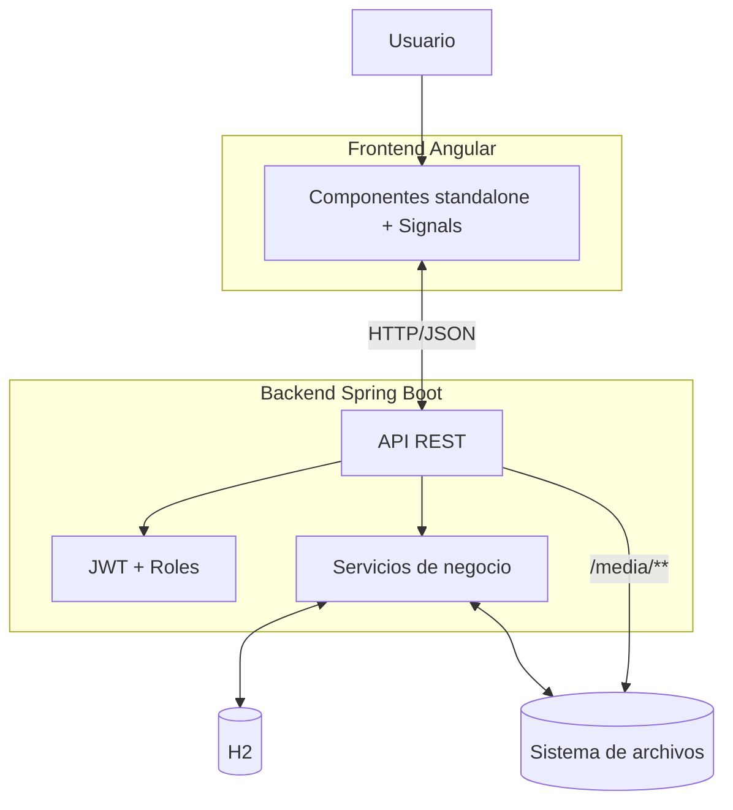

# Arquitectura del marketplace multivendedor

## Visión general

ParDrops evoluciona de una tienda monovendedor a un **marketplace multivendedor**. La plataforma permite que distintos vendedores gestionen sus propias tiendas, publiquen su catálogo, preparen sus pedidos de forma independiente y reciban notificaciones, mientras que la plataforma se encarga de la orquestación de compras, pagos y visibilidad pública.

## Arquitectura general

La aplicación sigue una arquitectura cliente-servidor con dos proyectos independientes:

- **Frontend**: Angular 22 (standalone components, signals, routing, guards). Se comunica con la API REST vía HTTP/JSON.
- **Backend**: Spring Boot 4 (REST, seguridad stateless con JWT, validación, JPA/Hibernate). Expone `/api/**`.
- **Persistencia**: Base de datos H2 en archivo (`./data/pardropsdb.mv.db`). Esquema creado/actualizado con `spring.jpa.hibernate.ddl-auto=update`.
- **Almacenamiento multimedia**: Sistema de archivos local (`./data/media/`), servido públicamente bajo `/media`.

## Componentes clave del marketplace

### Dominio y entidades

- **User** (`Role`: `CUSTOMER`, `SELLER`, `ADMIN`): cuenta autenticada. Un cliente puede solicitar convertirse en vendedor.
- **Store**: ficha comercial de un vendedor (`name`, `slug` único, descripción, contacto, logo/portada, `status`, propietario `seller`). Cada vendedor tiene, como máximo, una tienda.
- **SellerApplication**: solicitud para vender. Flujo `PENDING` → `APPROVED`/`REJECTED` con notas de revisión. Al aprobar, se asigna rol `SELLER`, se crea la tienda y se notifica.
- **Product**: pertenece a un vendedor (`seller`, `sellerId`, `sellerName`, `storeSlug`). Puede estar `active` (publicado/oculto). Los productos ocultos no aparecen en el catálogo público.
- **Order**: pedido global creado por cliente/invitado con datos de envío, totales (`subtotal`, `tax`, `shipping`, `total`) y estado global.
- **OrderSubOrder**: **parte del pedido por tienda/vendedor**. Agrupa las líneas (`OrderItem`) correspondientes a cada vendedor, con sus propios totales y estado (`PENDING`/`PAID`/`PREPARED`/`SHIPPED`/`DELIVERED`/`CANCELLED`). El cliente ve el estado por tienda en su cuenta.
- **OrderItem**: línea de pedido con `productId`, `seller`, `subOrder`, precio unitario y cantidad.
- **Notification**: avisos por usuario (`ORDER`, `PRODUCT`, `SELLER_APPLICATION`, `ACCOUNT`, `INFO`), con enlace opcional.
- **MediaAsset**: imagen subida por usuario autenticado, servida públicamente.

### Flujo multivendedor de compra

1. **Carrito**: el cliente añade productos (pueden ser de distintas tiendas).
2. **Checkout**: se crea `Order` con totales globales (impuestos/envío calculados por el backend).
3. **Agrupación**: `OrderService` agrupa las líneas por vendedor (`sellerId`) y crea un `OrderSubOrder` por vendedor. Si un producto no tiene vendedor asignado, se agrupa bajo la tienda plataforma (`ParDrops`).
4. **Notificación a vendedores**: cada vendedor con parte de pedido recibe una notificación.
5. **Preparación**: el vendedor gestiona su `OrderSubOrder` desde `/vendedor/pedidos` y avanza estados siguiendo las transiciones permitidas.
6. **Seguimiento**: el cliente consulta su pedido en `/cuenta` y visualiza el estado de **cada tienda** (`subOrders`).

### Seguridad y aislamiento

- **Stateless JWT**: filtro `JwtAuthenticationFilter`, sesiones sin estado.
- **Roles**: `@EnableMethodSecurity`, reglas en `SecurityConfig`. Rutas `/api/seller/**` requieren `ROLE_SELLER`; `/api/admin/**` requieren `ROLE_ADMIN`.
- **Aislamiento por vendedor**:
  - `SellerProductController` opera solo sobre productos del vendedor autenticado.
  - `SellerOrderController` solo devuelve y modifica subpedidos del vendedor autenticado.
  - `SellerDashboardService` filtra por `sellerId` en todas las consultas.
  - `StoreService` permite editar solo la tienda propia (`/api/stores/mine`).
- **Validación**: DTOs con Bean Validation, gestión centralizada de excepciones (`GlobalExceptionHandler`).
- **CORS**: configurado para orígenes de desarrollo.

### Integraciones frontend

- **Guards**: `authGuard`, `adminGuard`, `sellerGuard`.
- **Servicios**: `SellerService`, `StoreService` encapsulan llamadas a `/api/seller/**`, `/api/stores/**`, `/api/seller-applications/**`.
- **Rutas**: `/vender` (solicitud), `/vendedor/*` (panel privado con guard), `/tiendas/:slug` (tienda pública).
- **UX**: enlace a tienda desde ficha de producto y tarjeta de producto; estado por tienda en cuenta del cliente.
